<!-- ============================== HEADER ============================== -->

  

  

  
  

<!-- ============================== ABOUT ============================== -->

  

<table align="center">
<tr>
<td>

-  **Currently focusing on:** exploring new programming languages and coding methodologies
-  **Also interested in:** algorithm design and mathematics

</td>
</tr>
</table>

<!-- ============================== TECH ============================== -->
<h2 align="center">🛠️ Tech Stack</h2>

  
    
  

<!-- ============================== PROJECTS ============================== -->
<h2 align="center">🚀 Featured Projects</h2>

<table align="center">
<tr>
<td width="50%" valign="top">

### 🏠 [Kira Takibi](https://github.com/Burak3405/Kira_app)
Web app for landlords to track properties, tenants, contracts and monthly rent payments. Mobile-friendly, with a [live demo](https://burak1h.pythonanywhere.com/login). 
  

</td>
<td width="50%" valign="top">

### 🎡 [Pera](https://github.com/Burak3405/Pera)
Drag-and-wheel file converter & editor for Windows: 27 tools, 46 input formats — images, video, audio, PDF, Office and more. 
  

</td>
</tr>
<tr>
<td width="50%" valign="top">

### 🌦️ [Weather App](https://github.com/Burak3405/Python_weather_app)
Desktop weather application with a clean PyQt6 interface. 
 

</td>
<td width="50%" valign="top">

### 📈 [Stock Tracker Bot](https://github.com/Burak3405/Python_stock_tracker_bot)
Scrapes e-commerce sites and fires real-time Windows notifications when a product is back in stock. 
 

</td>
</tr>
<tr>
<td width="50%" valign="top">

### 🧮 [Matrix Calculator](https://github.com/Burak3405/Python_matrix_calculator)
CLI tool for dynamic matrix creation and linear-algebra computations. 
 

</td>
<td width="50%" valign="top">

### 🔐 [Encryption Program](https://github.com/Burak3405/Python_encryption_program)
Command-line utility that encrypts and decrypts text data. 
 

</td>
</tr>
</table>

…and more: <a href="https://github.com/Burak3405/Cpp_basic_password_generator">password generator</a> · <a href="https://github.com/Burak3405/Python_slot_game">slot game</a> · <a href="https://github.com/Burak3405/Python_wheel_spinner">wheel spinner</a>

<!-- ============================== STATS ============================== -->
<h2 align="center">📊 GitHub Stats</h2>

  
  

  

<!-- ============================== SNAKE ============================== -->

  <picture>
    <source media="(prefers-color-scheme: dark)" srcset="https://raw.githubusercontent.com/Burak3405/Burak3405/output/github-snake-dark.svg"/>
    <source media="(prefers-color-scheme: light)" srcset="https://raw.githubusercontent.com/Burak3405/Burak3405/output/github-snake.svg"/>
    
  </picture>

<!-- ============================== CONTACT ============================== -->
<h2 align="center">📫 Let's Connect</h2>

  
  <!-- TODO: e-postanı / LinkedIn'ini ekle, sonra bu yorumları kaldır -->
  <!--  -->
  <!--  -->

  

